# Brickout

A small, dependency-light Breakout-style canvas game written in strict TypeScript.

## Development

Requires Node.js 22 or newer.

```sh
npm install
npm start
```

This starts a local web server and opens the game in your browser. The source `index.html` cannot be opened directly with a `file://` URL because browsers do not allow TypeScript ES modules to load that way.

Move with the left and right arrow keys and launch with Space. On a touch screen, tap or drag directly on the game board to move the paddle; the first tap also launches the ball.

Press `P` or Escape to pause. The pause overlay provides restart, sound, and reduced-motion controls. High scores and accessibility preferences are stored locally in the browser.

## Gameplay

- Consecutive brick breaks build a visible, decaying score combo. Brick rows play different notes and level clears resolve into a chord.
- When one destructible brick remains, paddle bounces gain progressive aim assistance and the target receives a subtle highlight.
- Longer rallies gradually increase ball speed.
- Powerups include multiball, sticky paddle, slow motion, shield, lasers, super ball, and paddle size changes, with named pickup banners, timers, and paddle transformations.
- Brick behaviors include armored, moving, explosive, regenerating, and indestructible bricks, each with distinct visual armor, motion, blast, renewal, or metal-stripe graphics.
- Alien saucers announce their entry with an edge warning, then cross the arena and fire downward shots that the paddle must dodge; shields absorb one hit, and a ball strike destroys the saucer for 250 points.
- Level changes use named introductions, cascading bricks, countdowns, shockwave celebrations, and distinct background palettes.
- Ball trails, colored brick fragments, floating scores, reactive backgrounds, danger feedback, screen shake, hit-stop, paddle sparks, paddle deformation, and optional mobile vibration provide impact feedback.

For development without automatically opening a browser, run `npm run dev` and use the HTTP URL printed by Vite.

Add `?debug=true` to the URL to display the current frames per second.

## Android

The game includes a Capacitor Android project under `android/`. Install Android Studio and an Android SDK, then sync the latest production web build into the native project:

```sh
npm run android:sync
```

Open the project in Android Studio or run it on a connected device or emulator:

```sh
npm run android:open
npm run android:run
```

To build a debug APK directly:

```sh
cd android
./gradlew assembleDebug
```

The APK is written to `android/app/build/outputs/apk/debug/app-debug.apk`. Run `npm run android:sync` after changing web code so Capacitor receives the latest `dist/` bundle.

## Verification

```sh
npm run lint
npm test
npm run build
```

## Architecture

- `src/gameplay` owns state transitions, collision detection, and the frame-rate-independent update loop.
- `src/entities` creates entities and defines the typed powerup registry.
- `src/render` draws the background, entities, HUD, phase messages, and debug overlay.
- `src/data` contains level data and its runtime validator.
- `src/input` and `src/audio` isolate browser input and Web Audio behavior.
- `src/constants` contains domain-specific constants re-exported through one public object.
- `android` contains the generated Capacitor Android application and native Gradle configuration.

Level data is validated before the game starts. Unknown fields, unsupported powerups, invalid hit points, and malformed row sizes produce explicit errors.

## Application lifecycle

The browser loads `src/main.ts` as the application entry module. That small composition root creates and starts the application from `src/app/application.ts`. The application coordinator validates level data, loads preferences, creates the audio and rendering services, creates the initial game state and input controller, applies the canvas layout, and binds UI listeners.

The repeating game loop begins in the `frame(timestamp)` function inside `createGameLoop()` in `src/app/gameLoop.ts`. Calling `GameLoop.start()` renders the initial menu and requests the first animation frame. Every invocation of `frame()` schedules the next invocation after updating and rendering the current frame.

Open the game with `?debug=true&visualizer=true` to display the live code-flow visualizer. It shows which gameplay systems ran during the sampled frame, their execution times, current entity counts, recent game events, and the source file responsible for each system. On wide screens it sits beside the game; on narrow screens it appears beneath it. The visualizer is excluded from normal gameplay unless both query flags are enabled.

```mermaid
flowchart TD
    Browser[Browser loads index.html] --> Main[Evaluate src/main.ts]
    Main --> App[createApplication in src/app/application.ts]
    App --> Levels[Validate raw level data]
    Levels --> Services[Create audio, render assets, FPS tracker, and input controller]
    Services --> State[Create initial menu GameState]
    State --> Bind[Apply canvas layout and bind UI and viewport listeners]
    Bind --> InitialRender[Render initial menu frame]
    InitialRender --> Schedule[requestAnimationFrame frame]

    Schedule --> Frame[frame timestamp in src/app/gameLoop.ts<br/>Game-loop entry function]
    Frame --> Delta[Calculate frame delta]
    Delta --> Update[updateGame state, input, levels, delta]
    Update --> Effects[Update visual effects and process pause or phase transitions]
    Effects --> Playing{Is gameplay active?}

    Playing -- No --> PostUpdate[Return to frame orchestration]
    Playing -- Yes --> Timers[Update timers and slow-motion scale]
    Timers --> Controls[Update paddle controls]
    Controls --> Bricks[Update moving, regenerating, and exploding bricks]
    Bricks --> Balls[Update balls, collisions, paddle returns, and life loss]
    Balls --> Pickups[Update powerups and laser projectiles]
    Pickups --> Threats[Update aliens and enemy bullets]
    Threats --> Complete{All clear targets destroyed?}
    Complete -- Yes --> LevelComplete[Complete level and begin transition]
    Complete -- No --> PostUpdate
    LevelComplete --> PostUpdate

    PostUpdate --> Layout[Sync canvas layout and clear one-frame input]
    Layout --> PhaseUI[Sync pause, upgrade, or terminal UI after phase changes]
    PhaseUI --> Feedback[Play audio, update music, and provide haptics]
    Feedback --> Persist[Persist a new high score]
    Persist --> Render[renderGame draws background, entities, effects, HUD, and debug overlay]
    Render --> Terminal[Show terminal menu when the run ends]
    Terminal --> Schedule
```



`updateGame()` is the frame-rate-independent gameplay coordinator. It delegates work to focused systems under `src/gameplay/systems`; it does not schedule frames itself. Scheduling remains exclusively in the `frame()` closure owned by `createGameLoop()`, which keeps browser timing, feedback, persistence, and rendering outside the gameplay simulation.
